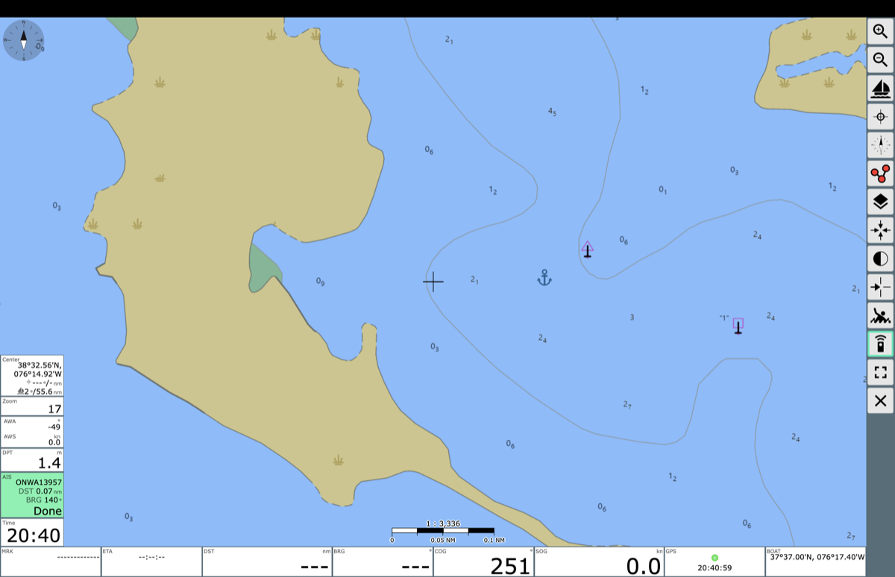
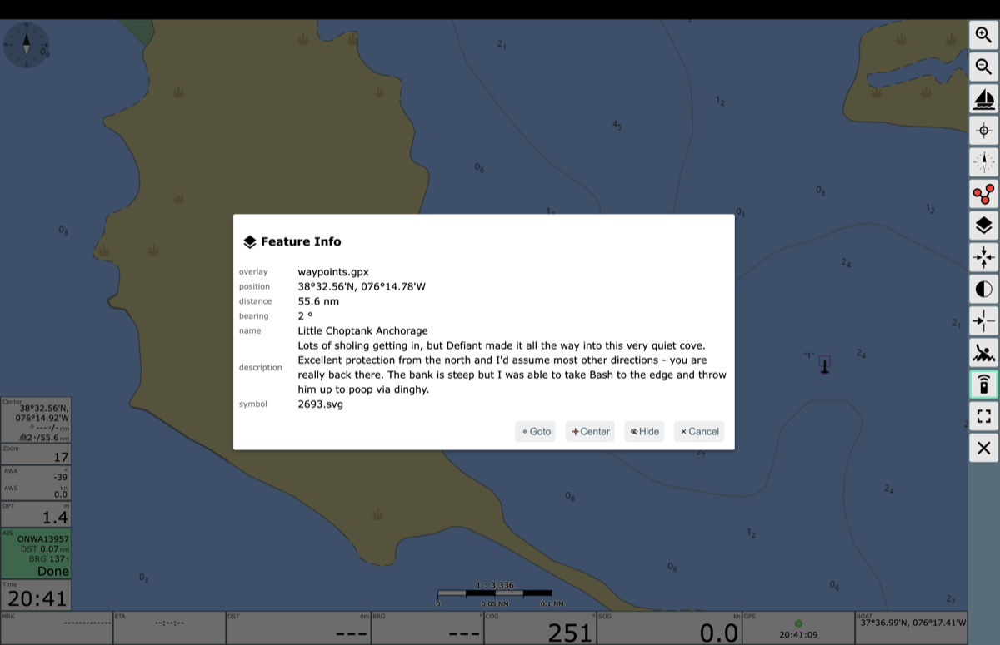

# Waypoints

A shared list of interesting and useful spots (anchorages, fuel, dog-friendly
shore access, etc.) that shows up as an overlay in [AvNav](https://www.wellenvogel.net/software/avnav/docs/beschreibung.html?lang=en)
on OpenPlotter.

`waypoints.csv` is converted to an overlay and sync'd on the hour - so whatever waypoints are in here show up on your plotter.



Tap a waypoint to see its name and description:



## How it works

- `csv_to_gpx.py` converts `waypoints.csv` to `waypoints.gpx`, turning
  coordinates into decimal degrees and downloading an icon for each emoji
  symbol into `waypoints-icons.zip`.
- `sync.sh` fetches `main` and, if anything changed, rebuilds both files into
  `/home/pi/avnav/data/overlays/`. If the boat is offline it keeps the
  existing files and tries again next hour.
- `install.sh` sets the above up on the Pi.

## Install (on an OpenPlotter Pi)

1. On the Pi, run the installer as any user with `sudo`:

   ```sh
   curl -fsSL https://raw.githubusercontent.com/pirate-baby/Waypoints/main/install.sh | bash
   ```

   This clones the repo to `/home/pi/Waypoints`, adds an hourly cron job for
   the `pi` user (the user AvNav runs as), and builds the overlay. It's safe
   to re-run. If AvNav runs as a different user, end the command with
   `| AVNAV_USER=<user> bash` instead.

2. In AvNav, open the chart's overlay settings, add `waypoints.gpx`, and set
   **icon file** to `waypoints-icons.zip`.

To force a rebuild when nothing has changed, delete the build stamp first:

```sh
sudo -u pi rm -f /home/pi/Waypoints/.last-built && sudo -u pi /home/pi/Waypoints/sync.sh
```

Problems (bad coordinates, failed icon downloads) are logged to
`/home/pi/Waypoints/sync.log`; the previous overlay stays in place until the
next good build.

## Symbols

Put an emoji in the `symbol` column and it's drawn on the chart as that icon.
Any emoji in [Twemoji 15.1](https://github.com/jdecked/twemoji) works. Some
handy ones:

| Emoji | Use for |
|-------|---------|
| ⚓ | Anchorage |
| ⛽ | Fuel |
| 🐕 | Dog-friendly shore access |
| 🍺 | Bar / restaurant |
| 🛒 | Groceries |
| 🔧 | Marine repair / chandlery |
| ⚠️ | Hazard / shoaling |
| 🏊 | Swimming |

Leave `symbol` blank to use AvNav's default point marker.

## Contributing

Add or edit rows in `waypoints.csv` and open a pull request.

| Column | Required | Example |
|--------|----------|---------|
| `name` | yes | `Wye River Anchorage` |
| `lat` | yes | `38°52.62'N` |
| `lon` | yes | `076°09.99'W` |
| `desc` | no | Notes shown when you tap the waypoint. Wrap in quotes if it contains commas. |
| `symbol` | no | `⚓` |
| `link` | no | `https://…` |

Coordinates can be degrees and decimal minutes (`38°52.62'N`), degrees,
minutes and seconds (`38°52'37"N`), space separated (`38 52.62 N`), or decimal
degrees (`38.877`, `-76.1665`).

Check your changes convert cleanly before opening the PR (Python 3, no extra
packages):

```sh
./csv_to_gpx.py
```

It prints the GPX, or lists every bad row with its line number.
